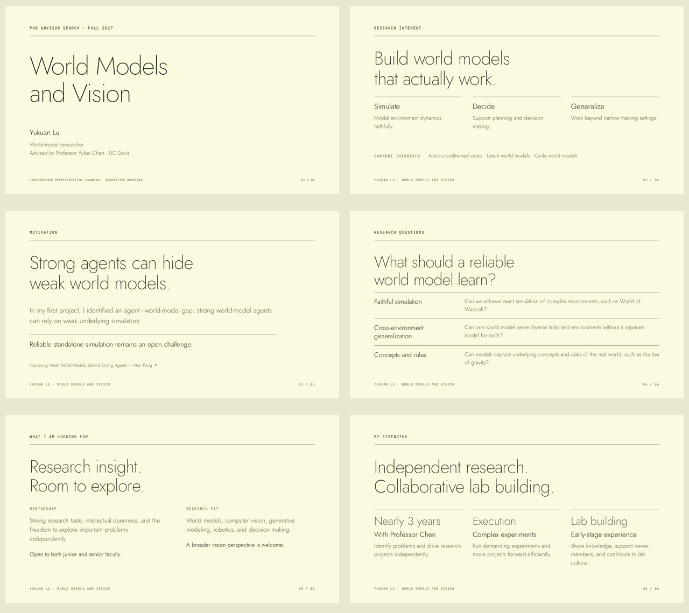

# Research Introduction Slides

> You can use AI to translate or explain this document and the rest of the project's documentation in your preferred language.
>
> 你可以使用 AI 将本文档和本项目的其他文档翻译成你偏好的语言，或为你解读其中的内容。

An English introduction to Yukuan Lu's research in world models and vision, prepared for Fall 2027 PhD advisor conversations.

The source is split into one readable HTML file per slide, shared CSS, separate browser scripts, and local fonts. A small Python builder produces a single offline-ready HTML file. The existing 16:9 layout, keyboard navigation, and browser text editing are preserved.



## Start editing

Requires Python 3.10+. Node.js and npm are optional for formatting.

```bash
npm install
npm run dev
```

Open [localhost:8000](http://localhost:8000), edit a source file, save, and refresh. Without Node, run `python3 scripts/deck.py dev`. Use `--port 8001` if the default port is occupied.

| What to change                         | File                          |
| -------------------------------------- | ----------------------------- |
| Slide text and markup                  | `src/slides/*.html`           |
| Slide order, page list, document title | `src/deck.json`               |
| Colors, typography, layouts, animation | `src/styles/deck.css`         |
| Navigation and scaling                 | `src/scripts/presentation.js` |
| Browser text editing and export        | `src/scripts/editor.js`       |
| Document shell and toolbar             | `src/index.html`              |

See [editing workflow](docs/workflows.md) for adding slides, browser drafts, and sharing. `src/index.html` is a template; preview it using the development server.

## Build and share

```bash
npm run build
# Or: python3 scripts/deck.py build
```

Open or share `dist/index.html`. Fonts, styles, and scripts are embedded, so it works offline. Do not edit generated output.

## Present

- Next/previous: arrows, Space, Page Up/Down, mouse wheel, or swipe.
- First/last: Home / End.
- Browser text editing: E; finish with Escape.
- Download a portable edited copy: Ctrl+S / Cmd+S or Save HTML.

Browser drafts do not update repository files. Make permanent edits in `src/slides/`.

## Format and test

```bash
npm run format
python3 -m venv .venv
.venv/bin/python -m pip install -r requirements-dev.txt
.venv/bin/python -m playwright install chromium
.venv/bin/python -m unittest discover -s tests -v
```

GitHub Actions checks formatting, builds, and tests navigation, offline layout, text overflow, draft persistence, and HTML export on pushes and pull requests.

## Research reference

[Improving Weak World Models Behind Strong Agents in Atari Pong](https://arxiv.org/html/2607.15142v3)

## License and attribution

Project code is MIT licensed. The embedded Jost and JetBrains Mono fonts retain their SIL Open Font License; license texts are in `licenses/`. The presentation was created using [Frontend Slides](https://github.com/zarazhangrui/frontend-slides), with the Monochrome / Ivory Ledger design direction. See [third-party notices](docs/third-party.md).

This project was written collaboratively by humans and AI.
